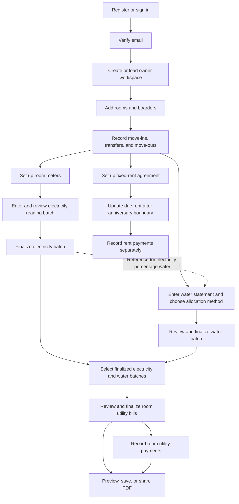

# Current App Owner Workflow

This guide demonstrates the current Boarding House Manager workflow: set up
your property, keep occupancy accurate, prepare utility batches, create room
bills, collect payments, and share PDF statements. Rent follows each boarder's
rental anniversary and has its own payment ledger.

## 1. Workflow at a glance



The recurring utility sequence is **electricity batch + water batch → room
utility bills → payments → PDF reports**. Normal selected-boarder allocation can be
prepared independently; electricity-percentage allocation needs an electricity
batch as its reference.

## 2. Access your boarding-house workspace

1. Register with an email address and password, or sign in to your existing
   account.
2. On Android or iPhone you can also tap **Continue with Google** to sign in
   with your Google account, from either the sign-in or registration screen.
3. Complete email verification before accessing boarding-house records. Google
   sign-ins are already verified and skip this step.
4. On first use, complete the boarding-house setup form to create your private
   owner workspace. Returning owners load their existing workspace.
5. Use the main navigation: **Home**, **Rooms**, **Boarders**, **Billing**, and
   **Settings**.

Use the same owner account on a replacement device to access the same records.
If you forget your password, use password recovery from the sign-in flow.
The current build needs a working connection to load and save business data;
when a network operation fails, reconnect and use the available retry action.

## 3. Set up rooms and keep occupancy current

### Rooms

1. Open **Rooms** and create each room.
2. Enter its name and monthly rent, and save the room.
3. Edit room details when needed. Deactivate rooms that are no longer in use,
   or reactivate them later.

### Boarders

1. Open **Boarders** and add each boarder's details.
2. Record the room and actual move-in date through the move-in flow.
3. Use the boarder's detail screen to maintain contact information and notes,
   transfer rooms, or record a move-out.
4. Deactivate a moved-out boarder when appropriate; historical occupancy remains
   available.

Multiple boarders can occupy the same room. Transfers close the old occupancy
and open the new one on the same date.

**Date rule:** occupancy is stored as `[moveInDate, moveOutDate)`. The move-in
date counts; the move-out date does not. For example, a June 16 transfer means
June 15 is the final day in the old room and June 16 is the first day in the
new room. Enter these events accurately before preparing water allocations.

## 4. Prepare an electricity reading batch

Open **Billing → Electricity**.

1. Set up each active room's meter and opening reading before creating a batch.
2. Create a reading batch and enter the effective reading date, time, and
   electricity rate per kWh.
3. Enter a new reading for every active room, or explicitly exclude the room
   and provide a reason.
4. Check each previous reading, new reading, consumption, and charge.
5. Select **Save draft** to continue later, or **Review batch** to inspect the
   complete batch.
6. Select **Finalize reading batch** once all values are correct.

Finalization records the included readings and updates room meters. The
finalized batch is read-only and becomes a source for room billing.

### Meter changes and mistakes

- A normal reading must extend the meter sequence on a later date and cannot
  be below its previous value.
- Use the reset, replacement, or clean-start flow for a physical meter change;
  record the reason, closing reading, and new opening reading.
- Use room reading history for the controlled correction action when a reading
  is eligible. It requires a reason and final review, and keeps a before/after
  audit record. Eligibility is limited to the latest active, unbilled reading;
  finalization does not make every reading freely editable.

## 5. Prepare a water billing batch

Open **Billing → Water → Create water batch**.

1. Enter the provider statement's coverage dates, receipt date, and total amount.
2. Choose the allocation method offered by the current batch editor:

   | Method | Allocation basis | Required information |
   | --- | --- | --- |
   | **Normal** | Equal shares among unique boarders included by the landlady, grouped by the chosen billing room | Occupancy evidence, inclusion decisions, exclusion reasons, and transfer room decisions |
   | **Electricity %** | Each room's share of a selected electricity batch, using charge or consumption as the basis | An eligible finalized electricity reference batch |

3. For **Normal**, review the eligible boarders whose occupancies overlap the
   statement coverage dates. Full-period occupants start included; partial-period
   arrivals, departures, or gaps require an explicit Include/Exclude decision.
   Every exclusion requires a reason. A transferred boarder is counted once;
   choose one of their occupied rooms for their entire share and explain the
   choice. Occupied days and move dates are supporting information only.
4. For **Electricity %**, select the reference batch and basis. When electricity
   and water periods differ, review the displayed dates and confirm that the
   difference is intentional.
5. Check the live selected count, per-boarder amounts, and room totals. Excluding
   someone redistributes the bill among the remaining included boarders. Zero
   included boarders prevents allocation and finalization.
6. Select **Review allocation**. Check room allocations, warnings, and any
   unallocated/landlady-paid amount.
7. Select **Save draft** to continue later, or **Finalize water batch** to save
   the read-only allocation snapshot.

Normal water divides integer centavos equally by included boarder count. Any
remainder centavos go to included boarders in ascending boarder-ID order. Days
are never a multiplication factor. Finalized batches preserve the eligibility
evidence, decisions, reasons, boarder shares, and room totals. Existing legacy
person-day records keep their original method and amounts. Electricity-based
water first uses room percentages, then occupancy to determine allocated and
unallocated amounts. A missing or zero electricity basis cannot produce a valid
percentage allocation.

**Reconciliation rule:** allocated water plus unallocated/landlady-paid water
equals the full provider bill. Unallocated water is shown explicitly and is
not added to a room's utility balance.

## 6. Create combined room utility bills

Open **Billing → Room bills & payments → Open dashboard → Create room bills**.

1. Select one finalized, unused electricity batch.
2. Select one finalized, unused water batch.
3. Review both source references and their dates. Electricity and water keep
   their own coverage periods; the combined bill does not require a single
   shared calendar month.
4. If the water allocation references a different electricity batch from the
   one selected for charging, review and explicitly confirm that association.
5. Review the room totals, then select **Finalize bills** in the confirmation.

The result is an immutable utility billing batch with a statement and payment
account for each room with a nonzero charge. Both selected source batches are
locked as used and cannot be reused to create another combined bill.

```text
Room utility bill = room electricity charge + allocated room water charge
```

Rent is tracked separately. The combined utility statement records a room
balance, without assigning a private payable share to each boarder. Allocation
details retained in source records do not create separate boarder utility
accounts in this workflow.

## 7. Record room utility payments

1. Open a combined bill from the dashboard or **Created bills**.
2. Find the room account and open its payment action.
3. Enter the amount, payment date, method, and any notes. Utility payment methods
   include cash, GCash, bank transfer, and other.
4. Save the payment and check the updated balance and payment history.
5. Record later payments against the same room account until its balance is zero.

| Payment state | Meaning |
| --- | --- |
| Unpaid | No payment has been recorded against a positive balance. |
| Partially paid | Some of the amount has been collected; a balance remains. |
| Paid | The full amount has been collected. |

Payments are append-only records. Recording one updates the payment account,
without rewriting the original statement. An amount above the outstanding
balance is rejected. The room billing dashboard shows billed, collected, and
outstanding utility totals; review rent in its own section.

## 8. Manage anniversary rent separately

Open **Billing → Rent**.

1. Select **Set up agreement** for an occupancy without a fixed-rent agreement.
2. Confirm the boarder/occupancy and agreed full monthly rent. The room's stored
   monthly rate supplies the starting amount for the agreement.
3. Review **Current coverage** for periods still in progress.
4. After a coverage period ends, select **Update due rent** to create completed,
   due rent cycles.
5. Record partial or full payments against the relevant rent cycle. The rent
   payment form records the amount, received date, and note.
6. When a boarder moves out with an incomplete extra stay, review **Move-out
   decisions** and record the decision. No extra-stay charge is added
   automatically.

### Anniversary example

For a June 10 start and agreed monthly rent of **₱3,000.00**:

| Coverage | Due date | Full rent |
| --- | --- | ---: |
| June 10–July 9 | July 10 | ₱3,000.00 |
| July 10–August 9 | August 10 | ₱3,000.00 |

A completed normal cycle owes the full agreed monthly amount. An in-progress
cycle is not charged early, and ordinary completed cycles are not prorated by
their number of days. Utility payments do not settle rent, and rent payments
do not settle room utilities.

## 9. Preview, save, and share PDF reports

1. Open a created room utility bill.
2. Select **Preview, save, or share PDF**.
3. Choose the utility summary or a room statement, selecting the room when
   applicable.
4. Check the source periods, charges, payments, and outstanding balances.
5. Use the save/print action to open Android's native print flow and save a PDF.
6. Use sharing to open the native share sheet, then select Messenger or another
   supported app and choose the recipient there.

PDF charges come from the saved utility snapshot. Reopening an older bill does
not recalculate its charges using today's rates, room assignments, or settings.
Payment information reflects the ledger supplied when the report is generated.

## 10. Worked example: one complete billing run

The following amounts are illustrative. Assume all named boarders occupy their
rooms for the entire June 1–June 30 water period, entered internally as
`[June 1, July 1)`, with no unallocated amount.

### A. Property and electricity

| Room | Boarders | Previous reading | New reading | Consumption | Rate | Electricity |
| --- | --- | ---: | ---: | ---: | ---: | ---: |
| Room 1 | Ana and Bea | 1,000 kWh | 1,100 kWh | 100 kWh | ₱12.00/kWh | ₱1,200.00 |
| Room 2 | Carlo | 2,000 kWh | 2,050 kWh | 50 kWh | ₱12.00/kWh | ₱600.00 |

Review and finalize the electricity reading batch. Total electricity is
**₱1,800.00**.

### B. Water allocation

Enter a **₱900.00** water bill, choose **Normal**, and include all three boarders:

| Room | Included boarders | Fraction of total | Water |
| --- | ---: | ---: | ---: |
| Room 1 | 2 | 2/3 | ₱600.00 |
| Room 2 | 1 | 1/3 | ₱300.00 |
| **Total** | **3** | **100%** | **₱900.00** |

If Carlo is excluded with a reason, Room 1 receives the entire ₱900.00 and
Room 2 receives ₱0.00. The preview shows this before finalization.

Review and finalize the water batch.

### C. Combined bills and payments

Select those two finalized batches and finalize room bills:

| Room | Electricity | Water | Utility bill | First payment | Remaining balance |
| --- | ---: | ---: | ---: | ---: | ---: |
| Room 1 | ₱1,200.00 | ₱600.00 | ₱1,800.00 | ₱1,000.00 | ₱800.00 |
| Room 2 | ₱600.00 | ₱300.00 | ₱900.00 | ₱900.00 | ₱0.00 |
| **Total** | **₱1,800.00** | **₱900.00** | **₱2,700.00** | **₱1,900.00** | **₱800.00** |

Room 1 is **partially paid** and Room 2 is **paid**. Record Room 1's later
₱800.00 payment to settle it, then regenerate the PDF to show the updated
payment information. Each boarder's anniversary rent is handled in **Rent**.

## 11. Record states and historical workflows

| Record/state | What it means for the owner |
| --- | --- |
| Draft electricity or water batch | Continue editing and reviewing before finalization. |
| Finalized utility source batch | Read-only source available for combined billing. |
| Used-in-billing source batch | Already attached to a combined bill; cannot be reused. |
| Voided water batch | Retained in history with its reason; a finalized, unused water batch has a void action. |
| Created combined utility bill | Immutable room charges, with payment balances maintained separately. |
| Unpaid / partially paid / paid | Collection progress, distinct from whether a source batch is finalized. |
| Legacy archive/history | Earlier calculations and billing records retained for historical review. |

Use the batch-based flow above for new combined utility bills. Historical
electricity/water calculators, legacy room billing months, legacy boarder bills,
and earlier prorated rent records can appear elsewhere in the app. Their
historical dates, calculations, and correction actions should not be assumed
to describe the current combined-bill workflow.

## 12. Recurring owner checklist

- [ ] Record move-ins, transfers, and move-outs with their actual dates.
- [ ] Confirm room meters and rates before entering the next electricity batch.
- [ ] Review and finalize the electricity batch.
- [ ] Enter the water statement, review its allocation, and finalize its batch.
- [ ] Select the intended source batches and review room totals and warnings.
- [ ] Finalize room utility bills and confirm they appear in created bills.
- [ ] Record utility collections against the correct room account.
- [ ] Set up missing rent agreements and update due rent after coverage ends.
- [ ] Record rent collections and resolve pending move-out decisions.
- [ ] Preview and save/share the appropriate PDF.
- [ ] Review remaining utility and rent balances in their respective sections.

## Implementation references

This guide follows the current batch editors and billing logic. Useful source
references when updating the workflow are:

- `lib/features/billing/presentation/billing_hub_screen.dart`
- `lib/features/electricity/presentation/electricity_batch_editor_screen.dart`
- `lib/features/water/presentation/water_batch_editor_screen.dart`
- `lib/features/water/domain/water_calculator.dart`
- `lib/features/billing/presentation/room_billing_finalize_screen.dart`
- `lib/features/billing/domain/utility_billing_models.dart`
- `lib/features/billing/presentation/utility_billing_detail_screen.dart`
- `lib/features/rent/presentation/rent_billing_screen.dart`
- `lib/features/billing/presentation/utility_billing_pdf_screen.dart`
